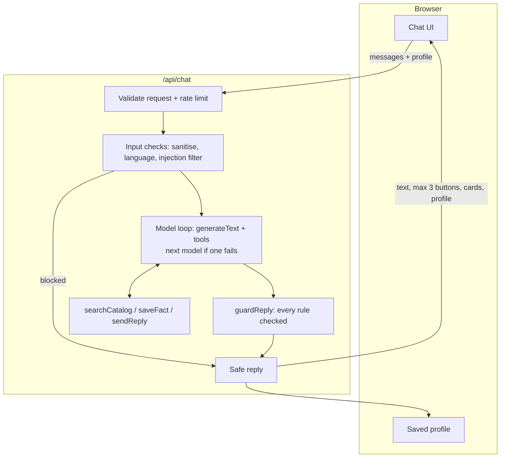

# Study Advisor

[](https://github.com/Filx2001/study-advisor/actions/workflows/ci.yml)

A small chatbot that helps a high-school student find a summer programme from a fixed catalog
(`data/catalog.json`). It asks one question at a time, then recommends, in **Arabic or English**,
and every reply is checked by server code before the student sees it.

Built with **Next.js 16**, **TypeScript** and the **Vercel AI SDK v7**.

## Features

- **Asks before recommending:** interest, budget (and currency), English level, one question per message.
- **Model-driven tools:** `searchCatalog`, `saveFact` and `sendReply`. The model decides when to call them.
- **Only programmes that fit:** the server checks every recommendation against the catalog _and_ the student's saved facts (field, budget, English level). If nothing fits, it shows the 3 closest real programmes, each labelled with what doesn't fit. If the server changes the cards, it also writes the text, so the two never contradict.
- **Every reply is text plus at most 3 buttons of at most 20 characters**, enforced on the server even when the model misbehaves.
- **Arabic and English**, detected per message, with a right-to-left UI for Arabic.
- **Honest when nothing fits:** shows the closest real programmes and says what doesn't fit (e.g. "slightly over your budget").
- **Works with Groq or Google Gemini**, and moves on to the next model if one fails.
- **Security layers** against prompt injection and abuse (see [Security](#security)).
- **117 unit and conversation tests** (including full conversations with a scripted, misbehaving mock model), plus **Playwright browser tests** on desktop and phone. No test calls a real model.

## Quick start

**Requirements:** Node.js 20.9+ (developed on Node 24), npm, and a free API key from
[Groq](https://console.groq.com) or [Google AI Studio](https://aistudio.google.com). One key is enough.

```bash
git clone https://github.com/Filx2001/study-advisor.git
cd study-advisor
npm install
cp .env.example .env.local        # Windows PowerShell: Copy-Item .env.example .env.local
```

Open `.env.local` and add at least one key:

| Variable                       | Required       | Description                                                                                                                                                                                 |
| ------------------------------ | -------------- | ------------------------------------------------------------------------------------------------------------------------------------------------------------------------------------------- |
| `GROQ_API_KEY`                 | one of the two | Groq API key                                                                                                                                                                                |
| `GOOGLE_GENERATIVE_AI_API_KEY` | one of the two | Google AI Studio (Gemini) key                                                                                                                                                               |
| `AI_MODELS`                    | no             | Models to try in order, as `provider:model`, comma-separated. Providers without a key are skipped. Default: `groq:openai/gpt-oss-120b,google:gemini-3.5-flash,google:gemini-3.1-flash-lite` |

| `MAX_CONCURRENT_TURNS` | no | Chat turns calling the model at the same time (default 4) |

| `MAX_QUEUED_TURNS` | no | Turns allowed to wait in line (default 20) |

| `MAX_QUEUE_WAIT_MS` | no | Longest wait in line before a friendly "busy" reply (default 15000) |

Then:

```bash
npm run dev
```

Open http://localhost:3000.

## Scripts

| Command                 | What it does                                                                                   |
| ----------------------- | ---------------------------------------------------------------------------------------------- |
| `npm run dev`           | Start the app in development mode                                                              |
| `npm test`              | Unit and conversation tests (no API key needed)                                                |
| `npm run test:e2e`      | Browser tests with Playwright, desktop and phone (first run `npx playwright install chromium`) |
| `npm run lint`          | ESLint                                                                                         |
| `npm run typecheck`     | TypeScript check, including tests                                                              |
| `npm run build`         | Production build                                                                               |
| `node scripts/chat.mjs` | Dev helper: chat with the running API from the terminal                                        |

CI (GitHub Actions) runs lint, typecheck, unit tests, the build and the browser tests on every push, plus a secret scan of the whole git history.

## How it works



1. The route validates the request with Zod and applies a rate limit.
2. The input is cleaned, its language detected, and obvious prompt-injection attempts are answered by the server without calling the model.
3. The model works with the tools until it calls `sendReply`. If a model fails or times out, the next one in `AI_MODELS` is tried. Each attempt works on its own copy of the profile, so a failed attempt changes nothing.
4. `guardReply` checks the reply and fixes it or replaces it with a safe fallback.
5. The browser keeps the updated profile and sends it with the next message (the server is stateless).

## Where each rule is enforced

| Rule                                         | Enforced in                                                                    | Tests                                   |
| -------------------------------------------- | ------------------------------------------------------------------------------ | --------------------------------------- |
| Ask before recommending                      | `guardReply`, `missingFactReply`                                               | `missing`, `conversations`              |
| One question per message                     | `keepFirstQuestion`                                                            | `text`                                  |
| Only catalog programmes that fit the student | `eligibleFor` (`lib/recommend.ts`), `guardReply`, `mentionsUnknownInstitution` | `strict`, `closest`, `e2e-mock`, `text` |
| Text plus 1–3 buttons, 20 characters max     | `sanitizeChoices`, default buttons                                             | `guards`, `buttons`, `e2e-mock`         |
| Reply in the student's language              | `detectLanguage`, `matchesLanguage`, `choicesInLanguage`                       | `language`, `text`, `conversations`     |
| Holds when the model misbehaves              | single `guardReply` gate, fallback, salvage, model fallback                    | `e2e-mock`, `salvage`, `chat`, `strict` |

## Security

Prompt injection can't be fully prevented, so the design does two things: make it **harder**, and make it **harmless**.

**Harder**

- **Input:** invisible and text-direction characters are removed, look-alike characters are normalised (NFKC), and length is capped. Common injection phrasings in English and Arabic get a polite server reply; the model never sees them. History sent by the browser is cleaned the same way.
- **Prompt:** student messages are treated as data, not instructions; the bot stays on topic and never reveals its instructions.

**Harmless**

- **Least-privilege tools:** `searchCatalog` only reads the catalog; `saveFact` only edits this request's copy of the profile. No database, network or file access.
- **Output guards:** every reply passes `guardReply`. Links are removed, replies that leak instructions or tool names are replaced, invented institutions are never shown, and programme cards come from the catalog, not from the model's text.

**App**

- Rate limit of 20 messages per minute per client; security headers (`X-Frame-Options`, `nosniff`, `Referrer-Policy`, `Permissions-Policy`); no `X-Powered-By`.
- Requests and the browser-sent profile are validated with Zod. API keys stay on the server, and errors are logged server-side, never sent to the browser.
- CI scans the full git history for leaked secrets (gitleaks).

**Known limitations:** the browser could forge chat history or the profile (every reply is still guarded); the rate limit is in-memory, per server instance; there is no Content-Security-Policy yet.

- A global queue limits how many turns call the model at once; extra turns wait in line, and when the line is full the student gets a friendly "busy, try again" reply instead of an error.

## Project structure

```
app/
  page.tsx              Chat UI (sidebar, buttons, programme cards, RTL)
  api/chat/route.ts     API route: validation, rate limit, runTurn
lib/
  chat.ts               One turn: input checks → model loop → guards
  models.ts             Model list from AI_MODELS (Groq / Gemini)
  tools.ts              searchCatalog, saveFact, sendReply
  prompt.ts             System prompt
  guards.ts             Output guards (the single gate)
  security.ts           Input sanitising, injection filter, link and leak checks
  rate-limit.ts         In-memory rate limit
  fallback.ts           Server-written safe replies and default buttons
  salvage.ts            Recovers replies a model wrote as plain text
  profile.ts            Fact parsing and validation
  search.ts             Catalog search and closest matches
  currency.ts           Fixed approximate rates to QAR
  language.ts           Arabic / English detection
  catalog.ts, schema.ts, types.ts
  recommend.ts          What may be recommended, decided by code from the saved facts
  queue.ts              Limits concurrent turns; friendly "busy" reply
data/catalog.json       The programme catalog
tests/                  (19 files, 130 tests)
scripts/chat.mjs        Terminal chat helper (development)
.github/workflows/ci.yml
```

## More

- [DECISIONS.md](DECISIONS.md): the main choices and trade-offs
- [AI_USAGE.md](AI_USAGE.md): how AI coding tools were used
- Currency conversion uses fixed, approximate rates (`lib/currency.ts`), only for comparing prices.
